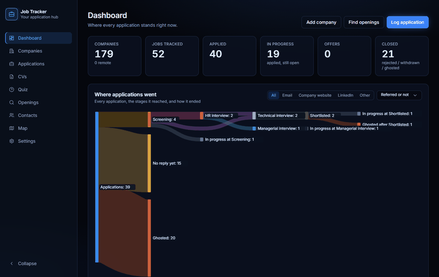

# Job Tracker

<p align="center"></p>

Local job-application tracker: every company, job and stage, with LinkedIn imports, contacts, a company map and a flow chart of where applications went.

**New here?** Start with the [getting started guide](docs/getting-started.md): install, first company and application, browser extension, LinkedIn contacts and backups.

## Install on Windows (one double-click)

1. Install [Node.js](https://nodejs.org) (LTS) and [Git](https://git-scm.com).
2. `git clone https://github.com/TheCoderOmar/job-applications.git`
3. Double-click **`setup.bat`** in the folder. It installs everything and puts a **Job Tracker** icon on your desktop.
4. Open the app from that icon from now on. It starts the app if it isn't running and opens it in your browser.

A new install starts with **177 companies** (tech companies and banks in Egypt and the Gulf, with their offices and logos). **Settings → Starter companies** adds back any you delete.

## Run from a terminal

```bash
npm install      # first time only
npm run dev
```

Open http://localhost:5173. The API runs on port 3001, and Vite proxies `/api` to it. `npm run shortcut` (re)creates the desktop icon.

Data is stored in `data/jobs.db` (SQLite). Back it up from **Settings → Export backup**.

## Updates

The app checks GitHub when it starts and every few hours. When there's a new version, a card in the corner says **Update available** with what changed; **Update now** downloads it and the app restarts by itself. If an update brings new packages, it asks you to close the app and open it again from the desktop icon, which installs them first. (It only updates a copy installed with `git clone`, on the `main` branch, without your own code changes.)

## Company locations

A company can have several offices. **Fill from LinkedIn** (or the browser extension on a company page) brings in every office listed under LinkedIn's **Locations**, and each one is put on the map from its address:

- With **OpenStreetMap** by default: free, no setup, but some pins land on the street or district instead of the building.
- With **Google** if you add a Google Maps API key in **Settings → Finding addresses on the map**: exact pins (Google's free monthly credit covers personal use).

Each office has a **Find on Google Maps** link. To fix a pin, paste the office's Google Maps link on the company; these formats work:

- Short share links: `https://maps.app.goo.gl/...`
- Place links: `https://www.google.com/maps/place/.../@24.71,46.67,17z/...!3d24.71!4d46.67`
- Plain coordinates: `24.7114, 46.6744`

On the **Map**, every office has a pin. Click one and all of that company's offices light up (the rest fade), zooming out if some are off screen.

Mark a company as **Remote** to keep it off the map until **Show remote companies** is turned on.

## Bulk import

Go to **Settings → Import JSON or CSV**. Open **Import formats** on that page for the column names. A jobs CSV needs at least the columns `company` and `title`.

## Stages

You can rename, recolor, reorder, add, and delete stages in Settings. A job counts as **applied** once it moves past the first stage, and the applied date is set to that day automatically.

## Applications: channel, referrers, connections

- **Applied via**: Email, Company website, LinkedIn or Other, plus the address or link you used.
- **Referred by**: up to 3 people per application (optional). Pick from your contacts (connections at that company are listed first) or type a new name.
- **Contacts → Import LinkedIn export**: on LinkedIn go to *Settings & Privacy → Data privacy → Get a copy of your data*, tick **Connections** (or, if it isn't listed, choose the larger archive "including connections"), then pick the `.zip` LinkedIn emails you. Only `Connections.csv` and `messages.csv` are read from it. Import it again any time; nobody is duplicated. Each job and company page then lists **your connections at that company**.
- **Status and favourites**: give each person a status (**Message sent**, **Chatting**, **Referred**) right in the list, filter by it, and star people to keep them on the **Favourites** tab. Adding someone as a referrer marks them Referred.
- **Talked to**: from `messages.csv` the app keeps, per connection, how many conversations and messages you had, how many they sent, and the last date. Message text is never stored. People who replied show a green **Talked** tag and are listed first in "Your connections at …" and in the referrer picker.
- **Dashboard → Where applications went**: a flow chart from applications to each stage reached and how it ended. You can filter it by channel and by referred / not referred.

## Your data stays local

Everything is stored in `data/jobs.db` on your own computer. The file is created on first run and is gitignored, so each person who clones this repo starts with a database of their own (with the starter companies, and nothing else). Set `JOBS_DB=path/to/file.db` to use a different file (handy for testing).

## Tests

```bash
npm test
```

## Companies from LinkedIn, logos, stars

- **Add company → LinkedIn company page**: paste a link like `linkedin.com/company/acme` and click **Fill from LinkedIn** (or just paste). It reads the public page and fills in the name, website, industry, size, founded, headquarters, about text and logo. Fields you already typed are kept.
- **Logos** are saved in your local database. They are looked up from the LinkedIn page, then the company website, then Google's icon cache, which only sees the domain. **Companies → Fetch missing logos** gets them for companies you already have. Click a logo on a company page to look it up again, use your own image, or remove it.
- **Interview stages**: Screening → HR interview → Technical interview → Final interview. When a job is closed (Rejected, Ghosted, Withdrawn), the app shows the furthest stage it reached, e.g. "Ghosted after Technical interview". The dashboard flow chart splits them the same way.
- **Stars**: click ☆ on any job (list, board or job page). Starred jobs sort to the top, and the **Starred** button filters to them.

## Applications vs openings

- **Applications** (the old Jobs page) is your log of what you applied for.
- **Openings** lists positions your companies have open right now. **Find openings** checks each company's public LinkedIn jobs (in the company's country) and its own careers page. Careers pages are read when they use a job board with a public feed (Greenhouse, Lever, Workday, SmartRecruiters, Workable, Ashby, Recruitee, BambooHR) or standard job-posting markup. Other careers pages are linked, not read.
- Search by words ("java cairo"), filter by company or source, star openings, hide ones you don't want, and see "New this week" or ones that have closed since the last check.
- **I applied** turns an opening into an application (Applied today, via LinkedIn or the website) and opens it so you can add referrers.
- If a company only has a LinkedIn *search* link, the check looks for its real company page by exact name and saves it, which also fetches its logo.

## Browser extension (Chrome / Edge)

Import what you're looking at straight into the app. It knows which kind of page you're on:

| Page | What the button does |
| --- | --- |
| LinkedIn, Workable, Indeed or Wuzzuf **job** | **Import job**: logs the application, filled in |
| LinkedIn **post** (a recruiter's "we're hiring") | **Import job from post**: the post becomes the description; the company is the page that posted it, one of yours named in it, or the employer in the author's headline |
| LinkedIn **company** page | **Import company**: the company with every office from its Locations; one you already have only gets the offices it's missing |
| LinkedIn **profile** | **Import contact**: name, position and company; their company is added too if you don't have it |

1. Open `chrome://extensions` (or `edge://extensions`), turn on **Developer mode**, click **Load unpacked** and pick the `extension` folder.
2. Pin **Job Tracker Importer**. With the app running, open one of the pages above and click the icon.
3. A small window opens beside the page, already filled in; your tab stays as it is. Check it and save, and the window closes. A company that isn't in your list yet is created when you save (or pick **+ New company…** and type it).

Company pages, profiles and posts are read from your own logged-in tab, so you see the same details LinkedIn shows you. Indeed and Wuzzuf block the app from reading their pages, so for them the extension sends the page you have open (pasting their links into the form won't fill it). On Indeed's search page it reads the job open on the right. After updating the extension (now 1.3.0), click **Reload** on its card once.

You can also right-click a link (or any page) → **Import this link to Job Tracker**. Other sites get their link and page title filled in. The popup shows a green dot when the app is reachable; change the app address under **App address** if it isn't `http://localhost:5173`. After changing extension files, click **Reload** on its card in the extensions page.

## License

[MIT](LICENSE)
